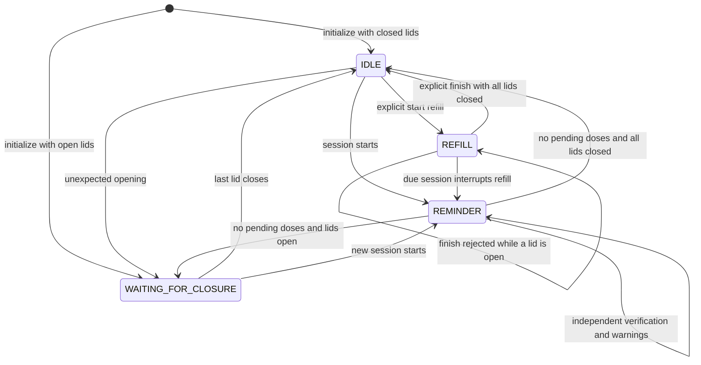

# State machine and event rules

There are four global states. Verification is per compartment, not a global
state: several due lids can be undergoing verification concurrently.

## Consolidated behavior

| Situation | Action |
| --- | --- |
| A session starts | Mark selected compartments pending; one shared deadline |
| A pending target opens | Start its own verification timer |
| That lid closes before dwell | BRIEF_OPENING; cancel only its timer |
| Dwell reached before deadline | ACCESS_CONFIRMED for that occurrence only |
| Deadline reached | DOSE_MISSED for each still-pending dose; confirmed doses unchanged |
| All outcomes determined | Finish session; request closure or go directly IDLE |
| Wrong compartment opens | WRONG_COMPARTMENT; no timer/target/deadline change |
| Previously confirmed compartment closes/reopens | REPEATED_ACCESS, including while another dose is pending |
| Lid remains open | No new edge or warning; closure remains outstanding |
| Unconfirmed lid opens outside reminder | UNEXPECTED_ACCESS; request closure |
| Refill starts from IDLE | Enter REFILL; preserve previous dose history |
| Lids move during refill | Log levels, suppress medication access and warnings |
| Refill finish requested with open lid | Request closure and remain REFILL |
| All lids close during refill | Remain REFILL until explicit finish |
| Dose starts during refill | REFILL_INTERRUPTED; reminder starts |
| Target already open at session start | Request closure; require close/reopen before verification |

No opening order is imposed. Simultaneous openings and staggered independent
verification are supported. Short attempts never accumulate and never extend the
session deadline. Pending does not mean verifying: a dose stays pending while
verification is in progress.

## Warning and history policy

Each new opening produces at most one access warning, plus a closure request.
REPEATED_ACCESS takes priority over WRONG_COMPARTMENT. A confirmed target reopening
while another target is pending is repeated access, not another confirmation.

A new occurrence for a compartment replaces its latest working history with
PENDING. Other compartments retain their outcomes. Refill suppresses warnings
without deleting history. After a missed dose, a later opening is unexpected (or
wrong during another reminder), never a retroactive confirmation. Warnings
describe observed access; they do not establish double dosing.

## Boundaries

- Defaults: 60000 ms window and 2000 ms minimum opening, both demo choices.
- At the exact session deadline, timeout wins over verification.
- Closing exactly at dwell can confirm if strictly before the deadline.
- No active session can be replaced by another; SESSION_CONFLICT preserves it.
  Starting a session after the old deadline first processes the old timeout.
- Startup seeds lid levels without inventing opening events or confirmations.
- Closures of wrong lids do not affect target verification.
- All open lids matter for closure, including wrong lids and non-target lids.
- Serial simulation begins with closed lids and volatile, empty history.
- Refill start is rejected during REMINDER or WAITING_FOR_CLOSURE.
- Physical debounce, clock faults and restart reconciliation are deferred.
  The current implementation loses history on restart.

`CLOSE_LID` events are emitted when closure is requested, not continuously on
every timer tick. The state and read-only lid records allow a future display to
keep the request visible. Physical output rendering is not implemented yet.
