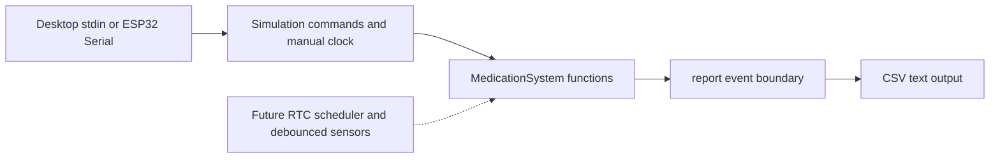

# Architecture — simplified version

The project now uses plain functions and fixed-size records. There is no class
hierarchy, generic event bus or separate hardware-driver framework.

## Read the code in this order

1. `MedicationSystem.h` defines the data and public operations.
2. `MedicationSystem.cpp` owns one four-element compartment array, one global
   state, settings and the shared session start time. Helpers are private.
3. `Simulation.cpp` implements commands and `MedicationSystem::report()`.
4. Entry points provide only text input/output.

The output boundary is a normal function. Simulation implements it; a later
physical application can supply a different implementation without changing the
access decisions. This build must link exactly one implementation. A single
function pointer sends text to either Serial or stdout; there is no inheritance.

## Data ownership

Each compartment record contains its current lid level, latest started dose and
outcome, membership in the current session, verification flag and opening time.
The array position identifies the compartment; no duplicate current-dose object
is kept. Outcomes belong to dated dose occurrences, not to a whole day.

Session membership is cleared at completion, but latest outcomes remain for
repeated-access detection. Starting a new dose replaces only its compartment's
latest record. The CSV stream contains past outcomes if the operator captures it;
there is no in-memory full history or persistent history.

`getCompartment()` returns a read-only pointer for status/testing. Invalid numbers
return null. `initialize()` resets the device and rejects invalid settings:
verification must be positive and shorter than the window; windows are at most
one day. Simulation uses the defaults 60000 ms / 2000 ms.

## Timing contract

`startSession()` means start now. The caller supplies a scheduled timestamp for
context; the session's elapsed deadline is measured from nowMs. A later scheduler
must not use this function blindly to recover overdue occurrences.

Call `update()` frequently and deliver debounced lid changes in timestamp order.
Unsigned subtraction handles millisecond-counter rollover for short windows with
regular polling. Backward jumps and outages spanning a full timer cycle are not
supported. A physical loop must sample frequently: this code cannot infer when
an unobserved lid movement happened.

A lid event first updates timers using the previous stable level, then applies
the new edge. Thus closing exactly at dwell can confirm, while the shared
deadline always takes priority. Simulation visits every millisecond when time
advances, avoiding skipped confirmations. Advance commands are capped at ten
minutes to bound synchronous demo work; this is not a hardware real-time loop.

`scheduledAt` will represent calendar seconds from a future RTC adapter. In the
current simulator it is artificial seconds since startup. It is not the
verification timer and is not yet a durable occurrence identifier.

## Deliberately deferred

- Automatic daily scheduling: group entries at the same instant; reject windows
  at different times that overlap. Current manual sessions reject active conflicts.
- Physical stable-edge sensing, initial sensor reads and output patterns.
- microSD logs, internal configuration/recovery data, and failure handling.
- RTC validity, DST/time changes, interrupted verification and reboot recovery.
- Networking/app integration. An app can request the same operations later; it
  should not become necessary for local reminders.

The old scheduler/interfaces are preserved in `reference/bootstrap-v1.zip`.
Their removal from the active build is intentional to keep this learning stage
focused on the behavior agreed with the project author.
